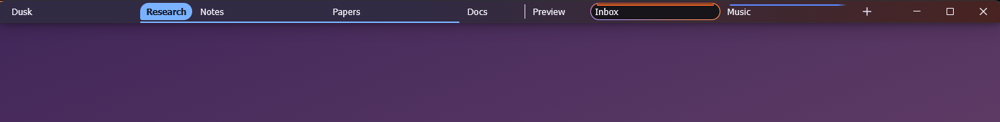
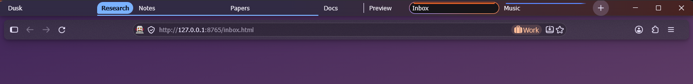
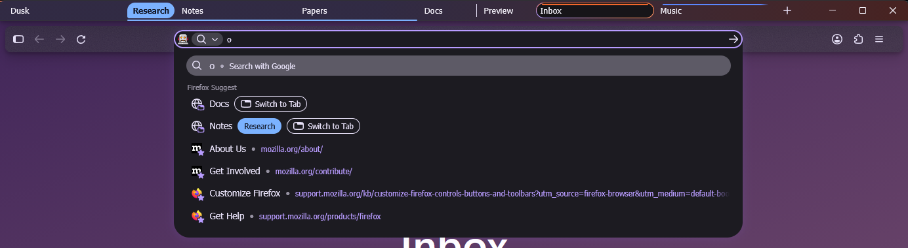
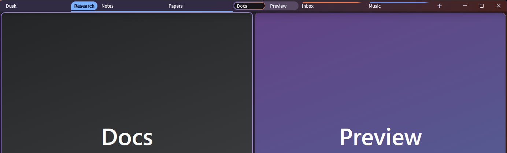
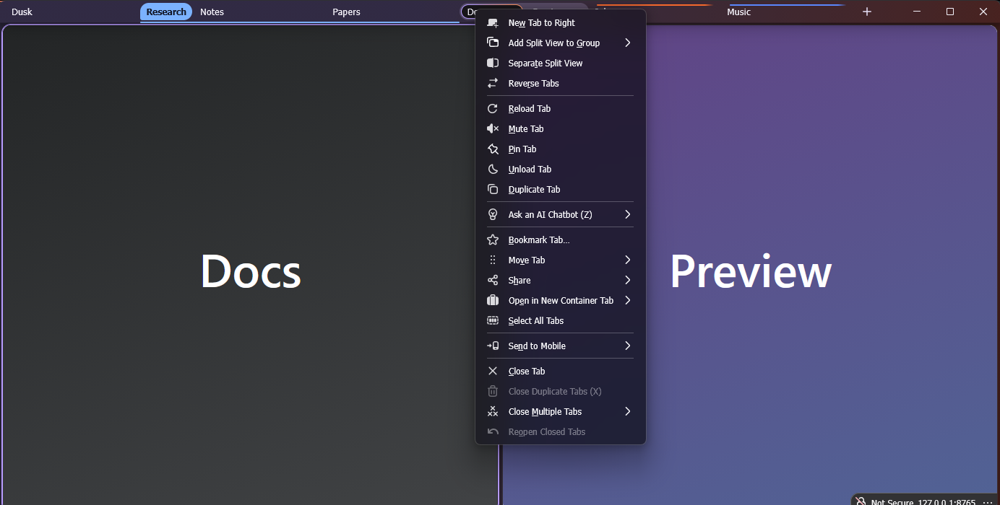

# firefox-round-userchrome

A userChrome.css for Firefox 160. The tab bar is 32px tall and is the only thing on screen. Hover over it and the address bar and bookmarks bar slide down over the page.

Based on [My round userChrome](https://gitlab.com/markonius/my-round-userchrome) by markonius.

## Screenshots

At rest, with a tab group (Research), a split view (Docs and Preview) and two container tabs (Inbox in Work, Music in Personal). The selected container tab's color runs down into its outline.

Hovering the tab bar drops the address bar in over the page.

With the address bar focused, the field and its dropdown are one dark panel that stays inside the field's width.

Split view. Firefox's own split view, with the 32px tab bar above it.

The tab context menu, with an icon on every item. Firefox ships most of these items without one.

## Install

1. Open `about:support` and click **Open Folder** next to Profile Folder.
2. Create a `chrome` folder there if it doesn't exist and put `userChrome.css` in it.
3. Put `user.js` in the profile folder itself. It sets `toolkit.legacyUserProfileCustomizations.stylesheets` to true. Firefox ignores `userChrome.css` without it.
4. Restart Firefox.

## Settings

Everything below is a CSS variable in `userChrome.css`.

| Variable | Default | Controls |
|---|---|---|
| `--uc-glass-tint` | `57%` | How solid the floating bars are. 0% is clear, 100% is solid. |
| `--uc-glass-noise` | `0.1` | Grain on the bars. 0 turns it off. |
| `--uc-active-bg` | bar color + 35% black | Color of the focused address bar and its dropdown |
| `--uc-dropdown-padding` | `8px` | Space around the dropdown results |
| `--uc-ripple-x` | `22%` | Where the focus ripple starts in the field |
| `--uc-ripple-color` | dark, 30% | How dark the ripple gets |
| `--uc-container-bleed` | `70%` | How far down a container tab's color reaches |
| `--tab-min-height` | `24px` | Tab height. The bar is this plus 8px. |

## Known limits

The bars can't blur the page behind them. I tested it on Firefox 160, and `backdrop-filter` in the browser UI never sees web content, because pages render in a separate process. The frosted look comes from tint and grain. The blur rule is still in the file in case a later Firefox allows it.

The focus ripple always starts at `--uc-ripple-x`. CSS has no access to where you clicked.

## What Firefox 160 broke

Most of the fixes in this version come from these upstream changes:

- `--toolbar-bgcolor` became `--toolbar-background-color`, and on Windows 11 it's now semi-transparent.
- `#urlbar-background` is now the class `.urlbar-background`.
- The address bar dropdown is a popover that positions itself and grows 8px past the field.
- Tabs use a bare `[selected]` attribute, so `[selected="true"]` matches nothing.
- `sync-off.svg` and `send-tab-20.svg` were removed.
- Group labels, split view and the tab outline all size themselves from `--tab-min-height`, so setting it to 0 breaks all three.
- Mini windows come with their own slide-in toolbar.
- The `border-area` background clip works in Firefox's built-in styles but not in userChrome.css.

## Editing live

In `about:config`, set `devtools.chrome.enabled` and `devtools.debugger.remote-enabled` to true. Press Ctrl+Shift+Alt+I to open the Browser Toolbox, then edit `userChrome.css` in its Style Editor tab. Changes apply as you type.
